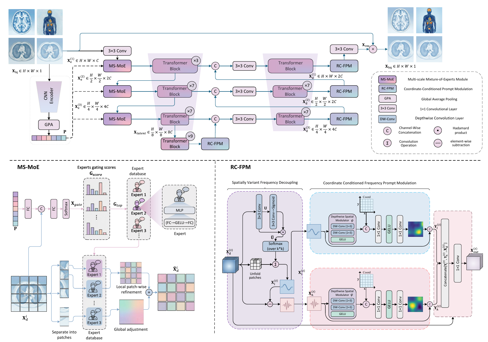

# AllFreqNet

**A Unified Frequency-Enhanced All-in-One Framework for Medical Image Restoration**

Zhouxian Lu, Xiangyun Hu, Pengwei Dong, Yunfei Zha, Jian Yao, Bo Su

[中文使用说明](README_zh-CN.md) · [Data preparation](docs/DATA.md) · [Implementation notes](docs/IMPLEMENTATION_NOTES.md)

PyTorch research code for joint CT denoising (**CT-DN**), CT metal artifact
reduction (**CT-MAR**), MRI super-resolution (**MR-SR**) and PET synthesis
(**PET-Syn**). The network combines Multi-Scale Mixture-of-Experts (MS-MoE)
with Region-Conditioned Frequency Prompt Modulation (RC-FPM).



*Manuscript overview; implementation details and figure/code differences are
documented below.*

This distribution cleans the supplied `version3` implementation and preserves
its network operations and checkpoint keys. Model files and classes use the
paper's names: `model/allfreqnet.py` → `AllFreqNet`, `model/ms_moe.py` → `MSMoE`,
and `model/rc_fpm.py` → RC-FPM components. See [the naming map](docs/NAMING.md)
and the implementation notes for
known differences from the manuscript. The manuscript's publication status,
DOI and public checkpoint link have not been supplied.

## Installation

Use an isolated Python environment. Python 3.10 or newer is a practical starting
point; a legacy Python 3.7 / PyTorch 1.13.1 CPU environment was also checked.
Install the PyTorch build appropriate for your CPU or CUDA environment using
the [official installer](https://pytorch.org/get-started/locally/), then:

```bash
python -m pip install -r requirements.txt
```

For DICOM input/export:

```bash
python -m pip install -r requirements-dicom.txt
```

The dependencies specify lower bounds, not a lockfile for the original paper's
training environment. CUDA training and a complete paper reproduction have
not been run as part of this cleanup.

## Dataset layout

Prepare aligned **2D LQ/HQ slices**, with identical filenames in each pair:

```text
datasets/All-in-One/
├── CT/
│   ├── train/{LQ,HQ}/
│   ├── validation/{LQ,HQ}/
│   └── test/{LQ,HQ}/
├── MA/                     # CT metal artifact reduction
├── PET/
└── MRI/
```

`MA`, `PET` and `MRI` use the same split structure as `CT`. Supported inputs:
`.npy`, `.nii`, `.nii.gz`, little-endian float32 `.raw`, legacy pickled `.bin`,
and optionally `.dcm`. RAW defaults to 512 × 512; override with `--raw-shape H W`.
See [data conventions and limitations](docs/DATA.md) before preparing data.
Patient data, split manifests and pretrained weights are not bundled.

## Training

Run commands from this repository's root. These single-line examples also work
in PowerShell; quote paths containing spaces.

```bash
python train.py --data-root datasets/All-in-One --modalities CT MA PET MRI --output-dir runs/AllFreqNet --device cuda
```

Defaults follow the supplied code and the R2 manuscript where specified:

| Setting | Value |
| --- | --- |
| Optimizer | Adam, betas (0.9, 0.999), eps 1e-8 |
| Learning rate | 2e-4 → 1e-6, cosine annealing |
| Iterations | 200,000 |
| Batch / patch size | 6 / 128 × 128 (from version3) |
| Validation interval | 1,000 iterations; all validation slices |
| Loss | L1 + 0.001 × classification CE + 0.001 × MoE balancing |
| Class labels | PET=0, CT=1, MRI=2, MA=3 |

Plain model checkpoints and a resumable training checkpoint are saved under
`runs/AllFreqNet/checkpoints/`. Validation CSV/JSON files and the run arguments
are recorded alongside them. Best-model selection uses mean per-slice PSNR
over all selected modalities, matching the original script's intended rule.

```bash
python train.py --data-root datasets/All-in-One --resume runs/AllFreqNet/checkpoints/training_state.pt --device cuda
```

Keep the original training settings when resuming. Resume restores the model,
optimizer, schedule and iteration; it does not restore the shuffled data stream
or exact random-number state. On PyTorch 1.x, resume requires ordinary pickle
loading, so use only checkpoints created by your own trusted training runs.
`--weights` initializes a model without resuming optimizer state.

## Evaluation

```bash
python test.py --data-root datasets/All-in-One --weights weights/Generator_iteration_199000.pth --output-dir results/test --save-images --device cuda
```

This writes per-slice `metrics.csv`, per-task and overall `summary.json`, and
optionally restored images. PSNR/SSIM use each target slice's range after
denormalization and clipping. CT/MA evaluation clips to [-1000, 1000] HU as in
version3. Constant targets have undefined PSNR/SSIM and are excluded from those
means; valid counts are reported. JSON uses `null` for non-finite values.
See [metric details](docs/IMPLEMENTATION_NOTES.md).

## Inference

Only the `LQ/` folders are required:

```bash
python infer.py --data-root datasets/All-in-One --weights weights/Generator_iteration_199000.pth --modalities CT --output-dir results/inference --output-format nii.gz --device cuda
```

Outputs can be `.npy`, `.nii` or `.nii.gz`. NIfTI spacing/origin/direction are
retained when exporting from a compatible NIfTI slice. Non-multiple-of-eight
images are padded on the right/bottom and cropped back after inference.

For a standalone uncompressed CT DICOM folder:

```bash
python infer_dicom.py --input-dir datasets/ct_dicom --output-dir results/ct_dicom --weights weights/Generator_iteration_199000.pth --modality CT --device cuda
```

Use `--modality MA` for metal artifact reduction and `--recursive` for nested
folders. This utility supports single-frame 2D CT DICOM only. Derived outputs
retain source metadata, including patient fields, and receive new series/SOP
UIDs; the utility does not anonymize data.

## Checkpoints and validation

See [weights/README.md](weights/README.md) for local checkpoint use and the public
release status. The original `Generator_iteration_199000.pth` loads strictly;
on a synthetic CPU input its output was bitwise identical before and after
network cleanup. Nine regression tests and a two-iteration synthetic training,
evaluation and inference workflow were checked. These checks establish software
behavior, not reproduction of manuscript performance.
Synthetic CT DICOM export and optimizer/scheduler resume were also checked.

```bash
python -m unittest discover -s tests -v
```

## Repository structure

```text
model/                  AllFreqNet and paper-aligned modules; checkpoint keys retained
data/                   Paired/unpaired slice loaders, normalization, I/O
evaluation/             PSNR, SSIM, RMSE and evaluation loop
train.py                Joint training and validation
test.py                 Paired evaluation
infer.py                LQ-only inference
infer_dicom.py          Optional CT DICOM inference/export
runtime.py              Device, checkpoint and output helpers
tests/                  Data and network regression checks
docs/                   Data conventions and implementation notes
weights/                Checkpoint instructions (no model files)
third_party/            Upstream license notices
```

## Citation and acknowledgments

The R2 manuscript was supplied locally. Use the manuscript citation below until
final publication metadata becomes available:

```bibtex
@misc{lu2026allfreqnet,
  title={AllFreqNet: A Unified Frequency-Enhanced All-in-One Framework for Medical Image Restoration},
  author={Lu, Zhouxian and Hu, Xiangyun and Dong, Pengwei and Zha, Yunfei and Yao, Jian and Su, Bo},
  year={2026},
  note={Manuscript}
}
```

The implementation builds on [AMIR](https://github.com/Yaziwel/All-In-One-Medical-Image-Restoration-via-Task-Adaptive-Routing)
and [Restormer](https://github.com/swz30/Restormer). The SSIM convention follows
[pytorch-ssim](https://github.com/Po-Hsun-Su/pytorch-ssim). The supplied Apache-2.0
license is retained; upstream MIT notices are included in `third_party/`. See
[NOTICE](NOTICE) for attribution. This repository contains research code.
